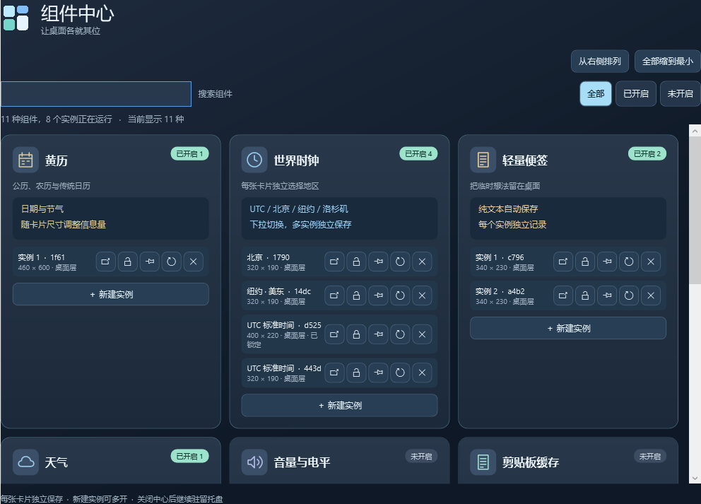

# DeskWidgets

可扩展的 Windows 桌面小组件宿主，使用 C# 14、.NET 10、WPF 与 WebView2。组件采用原生 HTML / CSS / ES Modules，**没有 npm 或前端构建依赖**。

[下载 Release](https://github.com/kongliuli/DeskWidgets/releases/latest) · [使用说明](docs/component-center.md) · [更新记录](CHANGELOG.md) · [MIT 许可证](LICENSE)



## 下载与启动

1. 下载 Release 中的 `DeskWidgets-v0.1.0-win-x64.zip`，完整解压到当前用户可写的固定目录。
2. 运行 `DeskWidgets.exe`。x64 发布包包含 .NET 运行时，不需要另装 .NET。
3. 若提示缺少 WebView2，请安装 [Microsoft Edge WebView2 Evergreen Runtime](https://developer.microsoft.com/en-us/microsoft-edge/webview2/)。该运行时没有随 ZIP 捆绑。
4. 双击托盘图标打开组件中心，选择组件或新建实例；退出也从托盘菜单操作。

首个版本面向 Windows x64，已在 Windows 10 22H2 / build 19045 上做本机验证；Windows 11、其他 Windows 版本及硬件组合需实际验证。目标 API 平台下限 10.0.17763 不等于全部旧系统都已验证；受支持系统以 [.NET 10 系统要求](https://github.com/dotnet/core/blob/main/release-notes/10.0/supported-os.md) 与 WebView2 要求为准。

发布包未签名，没有安装器或自动升级。不要只复制 EXE，`widgets/`、`assets/` 和运行时文件必须一起保留。首次启动打开 UTC、北京、纽约、南京天气与黄历；以后恢复上次布局。

## 内置组件

| 入口 | 功能 |
| --- | --- |
| 世界时钟 | 独立多实例；下拉选择 UTC、北京、纽约、洛杉矶，默认背景随地区切换 |
| 天气 | 新建选择城市，支持全球检索；七种 Canvas 天气场景与逐小时预报 |
| 黄历 | 离线农历、节气、传统宜忌等，随尺寸调整信息量 |
| 系统资源 | CPU / GPU / 内存，进度条、雷达、环形、折线，大尺寸四图同屏 |
| 音量与电平 | 主音量、静音、音量前数字信号峰值 dBFS |
| 剪贴板缓存 | 文本与图片，单列单行预览、全文/原图复制、搜索、暂停、滚动历史 |
| 随手记 | 独立草稿、历史便签、可拖出并点击穿透的桌面便签 |
| 日程倒计时 | 本地事件与倒计时 |
| 媒体播放 | 系统公开媒体会话，上一首、播放/暂停、下一首 |
| 专注与短待办 | 一个专注目标与可恢复计时 |
| 工作区入口 | 用户配置的本机文件夹、已有 `.lnk` 和 HTTP(S) 地址 |

- 组件中心将已开启、未开启和多开实例放在同一页；新建时钟/天气先选择地区。
- 支持透明背景、组件内部毛玻璃、图片/GIF/视频背景、锁定、置顶/沉底。
- 拖动与八方向缩放使用虚框，松手后一次性提交；可从右侧排列或全部缩到最小。
- 前台全屏时统一隐藏、挂起组件，停止原生采样与剪贴板监听，退出后恢复。
- 默认不启用开机自启；显式点击菜单才修改当前用户 Run 注册表项。

旧时区目录是兼容别名，实际加载统一的 `world-clock` 源码；旧 `weather` 实例保留原界面并归入天气入口。当前有 11 个逻辑入口，15 个可恢复的插件目录。

## 数据与升级

| 数据 | 位置与行为 |
| --- | --- |
| 布局及地区元数据 | 程序目录 `config.json` |
| 历史/桌面便签 | 程序目录 `notes-history.json`，保留上一版本 `.bak` |
| 前端偏好、草稿、天气缓存 | `%LOCALAPPDATA%\DeskWidgets\WebView2`，按实例 profile 隔离 |
| 剪贴板缓存 | 仅宿主内存；退出清空，不自动导入 Win+V 历史 |

升级前从托盘退出旧版并备份数据。将新版解压后保留原 `config.json`、`notes-history.json` 与 WebView2 用户数据；保留实例 ID 才能继续对应原 profile。发布 ZIP 不含个人布局、便签、运行日志或用户 profile。单实例限制会阻止同时启动第二个普通宿主。

剪贴板只在组件开启且未暂停时采集；全屏期间暂停，恢复时读取当前项。文本超过 1 MiB、PNG 超过 16 MiB 或图片超过 16×1024×1024 像素时整条拒绝，总缓存上限 64 MiB / 100 条。来源声明不加入历史时会跳过，但不能保证自动识别所有敏感内容。图片文件路径列表不是图片像素。

## 构建、验证与发布

源码构建需要 Windows 与 .NET 10 或更高兼容 SDK；`global.json` 允许向更高稳定 SDK 滚动，语言版本固定为 C# 14。

```powershell
dotnet build -c Release
# Node 只用于开发断言，不是应用运行依赖：
Get-ChildItem tests/*.mjs | ForEach-Object { node --test $_.FullName }
# 在独立副本和独立 profile 中验证，不直接运行 --self-test：
./tests/host-smoke.ps1 -Configuration Release
# 生成自包含 ZIP；输出路径必须是一个尚不存在的新目录：
./scripts/publish.ps1 -OutputDirectory C:/Builds/DeskWidgets-v0.1.0
```

原生宿主检查需要有交互式 Windows 桌面与 WebView2 Runtime，使用独立 Mutex 和测试 profile；不读写用户系统剪贴板、不改变音量、不操作实际播放器，也不修改开机自启。自测入口拒绝在已有布局/便签的目录运行。

详细验证范围与局限见 [使用说明](docs/component-center.md)。尚未完成所有混合 DPI、Explorer、独占游戏、跨应用图片粘贴和长期常驻场景的实机覆盖；通过编译或自动检查不代表这些场景已全部兼容。

## 项目结构

- `DeskWidgets.slnx` 汇总三个 SDK 风格项目。`Directory.Build.props` 统一编译设置，`Directory.Packages.props` 管理 NuGet 依赖版本。
- `src/DeskWidgets.Core/` 包含挂件与便签模型，以及布局仓储、便签仓储、挂件目录的接口，目标框架为 `net10.0`。
- `src/DeskWidgets.Infrastructure/` 实现 JSON 布局仓储、便签历史仓储和文件系统挂件目录，仅引用 Core。
- `src/DeskWidgets/` 包含 WPF/WebView2 桌面宿主。`App.xaml.cs` 组装接口与实现，`Presentation/` 管理窗口和交互，`Platform/` 包含剪贴板、音频、媒体、遥测和 Win32 适配，`SelfTests/` 保留需要实际宿主进程的集成检查。
- `widgets/`：组件前端、共享运行库和素材；兼容旧时区目录。
- `tests/`：前端断言、独立宿主检查脚本和最小测试夹具。
- `scripts/`：可重复执行的发布打包入口。
- `docs/`：使用说明、设计参考及标注范围的开发记录。
- `licenses/`：第三方原始许可和声明。

GitHub Actions 只运行 Windows 构建和前端断言；有交互式桌面的宿主验证需在本机运行，不用 CI 构建成功冒充 Win+D、鼠标或显卡兼容性验收。

本地 Release 宿主输出位于 `src/DeskWidgets/bin/Release/net10.0-windows/`。布局与便签文件仍按可执行文件所在目录定位，使用现有 JSON 格式。

## 插件开发

在可执行文件旁的 `widgets/` 新建目录，放入 `index.html`、`widget.json`、CSS 和原生 ES Modules，无需重新编译 C#。修改运行目录中的文件会在 300 ms 防抖后热重载；修改源目录后需要重新构建/复制。全屏休眠中的重载会延后。

```json
{"name":"My Widget","defaultWidth":320,"defaultHeight":190,"minWidth":240,"minHeight":140}
```

```js
import {mountHost, setupSettings} from 'https://assets.widgets.local/runtime.js';
const widget = document.querySelector('.widget');
mountHost(widget);
setupSettings(widget, {background: {type: 'none'}});
```

每个实例映射独立 HTTPS 来源，支持 ES Modules，不使用 `file://`。拖动桥由共享运行库处理；自定义拖动时还须发送移动/释放/取消消息，不能只发 `startDrag`。详细契约与布局见 [组件说明](docs/component-center.md)、[天气引擎](docs/weather-card.md)、[外观设置](docs/widget-appearance.md)。

插件是用户信任的本机代码，origin/profile 隔离不是恶意插件的操作系统沙箱。CSS 毛玻璃模糊组件内部背景，不保证模糊真实壁纸。不要在未经信任的插件中暴露额外原生能力。

## 来源与许可证

本项目采用 [MIT](LICENSE)。第三方组件保留各自许可，见 [第三方声明](THIRD-PARTY-NOTICES.md)。黄历的 lunar-javascript 原始许可与版本记录保留在 `widgets/almanac/vendor/`。背景素材及图标由项目创建，生成提示词保留在 `docs/`。

天气与城市检索使用 Open-Meteo；请求会发送所选城市坐标/搜索词，不使用设备定位权限。免费服务的商业使用限制与数据归属遵循 [提供方条款](https://open-meteo.com/en/terms)，不因本项目采用 MIT 而改变。黄历内容为传统历法资料，不是科学预测。
